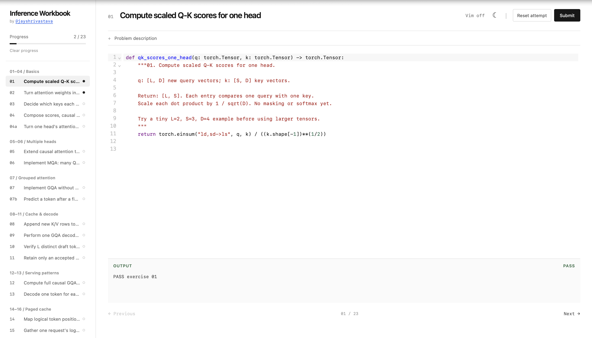

# Inference Workbook

Practice inference engineering with 23 small PyTorch exercises, from attention math to KV caches and paged attention.



Submissions run in your browser. The checker tries [torch-pyodide](https://github.com/celsowm/torch-pyodide) on WebGPU first, then falls back to [CPU PyTorch in Pyodide](https://github.com/mmtftr/pyodide-pytorch). Your code and progress stay in your browser.

## Run locally

```bash
npm ci
npm run build:pages
npx vite preview --base /inference-workbook/
```

Open <http://localhost:4173/inference-workbook/>.

## License

[AGPL-3.0-only](LICENSE).
